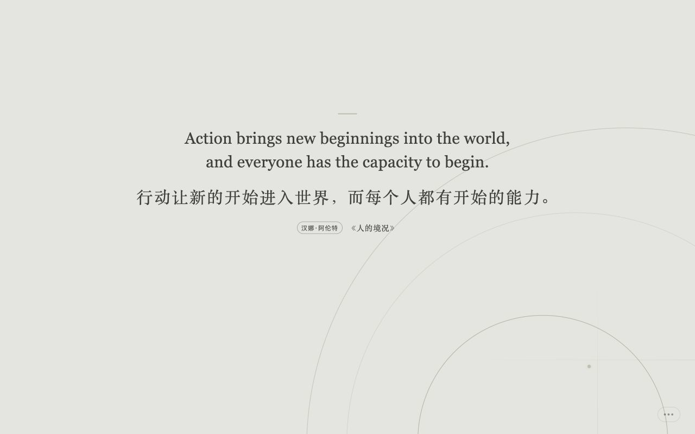

# 未定稿｜思想与知识新标签页

> 一页，一种思想。
> **NOTHING FINAL — One page, one idea.**

[](https://github.com/NorthGateChat/agora-philosophy/actions/workflows/ci.yml)
[](LICENSE)
[](CONTENT_LICENSE.md)

「未定稿 / NOTHING FINAL」把浏览器新标签页变成一张可以继续展开的知识卡：每次遇见一种思想，点开后继续阅读原文或命题整理、出处、解读、思想关系与留给当下的问题。

它不只是一面“金句墙”，也不要求用户专门腾出一段完整时间上课。预设内容覆盖多种思想传统与知识领域，用户还可以导入自己的知识集，让日常反复经过的新标签页成为轻量、持续的学习入口。



## 当前能力

- 七个内置内容库：西方哲学、中国哲学、毛选、科学思想、经济思想、心理学与印度哲学
- 当前完整公开目录共 1,452 张卡：西方哲学 600、中国哲学 101、毛选 128、科学 94、经济 300、心理 120、印度哲学 109
- 支持导入、管理和切换自定义知识集，让自己的材料也能以同样的单卡方式出现
- 每张卡统一区分“原文节选”“命题整理”“待核摘录”，不把编辑转述冒充作者原话
- 详情页提供核心解读、语境、辨析边界、来源档案、相关观点与思想关系
- 已核原文卡可从短引直接落到所在的完整篇章、论文、序言或其他自然阅读单元；520 个正文随站点与扩展按需加载，另有 140 个单元保留原典入口
- 支持简体中文、繁体中文和英文；中文模式可同时显示英文
- 多种独立视觉主题、克制的环境动效与全屏单焦点布局
- 鼠标、触摸与键盘操作：`←`、`→`、`Space`、`Enter`、`F`、`S`、`D`、`Esc`
- 新标签页尽量避免连续重复；跨集随机先选择内容库，再从库内选择内容
- 收藏、屏蔽、回顾与分享；分享图支持 1:1、3:4、4:5、9:16 和 16:9
- Chrome Manifest V3 新标签页扩展：零权限、无后台脚本、无远程代码、离线可用
- 偏好、自定义知识、收藏和屏蔽记录只保存在当前站点或扩展的本地浏览器存储中（IndexedDB / `localStorage`）

## 立即使用

- [Chrome Web Store](https://chromewebstore.google.com/detail/imejfeghpobgmbnebcmmndkghbcmjcca)
- [隐私说明](docs/PRIVACY.md)
- [内容方法与来源原则](docs/CONTENT-METHODOLOGY.md)

## 本地开发

需要 Node.js `>=22.13.0`。

```bash
npm install
npm run dev -- --port 3001
```

打开 `http://localhost:3001/`。提交前运行完整检查：

```bash
npm run lint
npm test
```

## 构建 Chrome 扩展

```bash
npm run build:extension
```

生成目录为 `extension-dist/`。在 `chrome://extensions/` 开启开发者模式，选择“加载已解压的扩展程序”，然后选中该目录。

生成可上传到 Chrome Web Store 的 ZIP：

```bash
npm run package:extension
```

产物位于 `release/`；商店图标、截图与宣传图位于 `store-assets/`。

## 项目结构

```text
app/                     网站与扩展共享的 React 体验
content/                 七个预设内容库、来源证据与思想关系
extension/               Chrome 新标签页入口
lib/                     随机选择、自定义知识与共享逻辑
scripts/                 扩展清单、图标、商店素材与 ZIP 生成
tests/                   SSR、本地化、内容、品牌与扩展产物检查
docs/                    内容、品牌、隐私与发布说明
brand.json               品牌、版本、链接与多语言描述
```

## 原文、译文与命题整理

首页内容使用统一的三态展示规范：

1. **原文节选**：已经按明确版本与位置核对的来源片段；删节必须显式使用省略号。
2. **命题整理**：项目依据所列材料压缩、重述或综合的观点；界面不用引号，并以“据……整理”归属。
3. **待核摘录**：用户导入或编辑流程中尚未完成来源复核的候选摘录；不会因为填写作者或作品就自动升级为原文。

经过逐字核查的原文卡会登记核查日期、版本与公开证据链接。中文今译、英文研读译文、核心解读、问题与思想关系属于项目编辑内容，不能反过来当作原典、史料、官方译文或唯一解释。不同传统与作品的版本、章号和通行译名可能有差异，正式引用前仍应回到实际采用的版本复核。

七个内容库采用非均衡策展：人物与卡片数量取决于材料密度、可定位性、思想差异与谱系作用，不表示人物排名，也不声称构成“最全数据库”。完整规则见[内容方法与来源原则](docs/CONTENT-METHODOLOGY.md)。

如果你发现归属、作品、年代、翻译或思想关系存在问题，请提交[内容纠错](https://github.com/NorthGateChat/agora-philosophy/issues/new?template=content-correction.yml)，并尽量提供原典位置或可靠研究来源。

## 独立设计与 AI 使用

「未定稿」研究过诗词、语录、冥想和知识型新标签页产品这一成熟类别，但没有复制第三方产品的源代码、数据、字体、插画或动画算法。界面、内容模型、思想关系交互和视觉主题均在本项目内独立实现，详见[设计来源说明](docs/DESIGN-PROVENANCE.md)。

AI 参与了部分代码协作、编辑性译写与发布材料整理；AI 输出从不作为史料来源。公开内容仍需要人的复核和可追溯来源，详见 [AI 使用声明](docs/AI-USE.md)。

## 参与贡献

欢迎修复错误、改进无障碍体验、补充可靠来源，或提出新的内容库与思想关系。内容贡献与代码贡献的要求见 [CONTRIBUTING.md](CONTRIBUTING.md)。

## 许可证

| 范围 | 许可证 |
| --- | --- |
| 源代码 | [GNU GPL v3 或更高版本](LICENSE) |
| 项目原创文本、数据结构与视觉素材 | [CC BY-SA 4.0](CONTENT_LICENSE.md) |
| 「未定稿 / NOTHING FINAL」名称、标志和商店识别 | 保留商标权利，见 [TRADEMARKS.md](TRADEMARKS.md) |
| 第三方依赖 | 各自许可证 |

作者姓名、年代、作品名等事实不因收录在本仓库而产生新的专有权利；公共领域原典仍保持公共领域状态。
